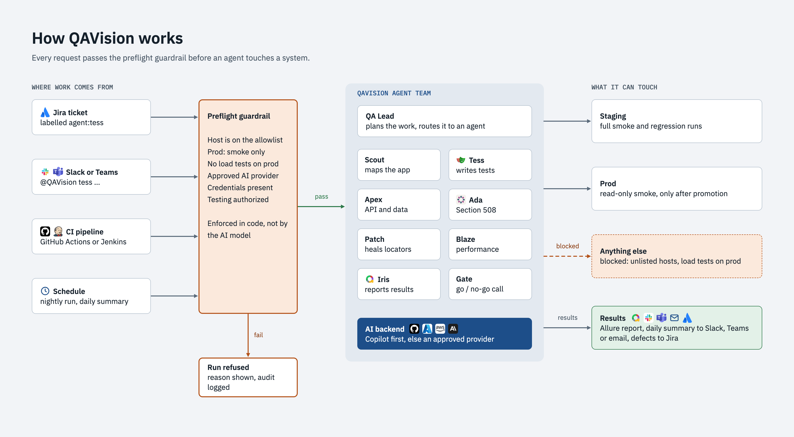
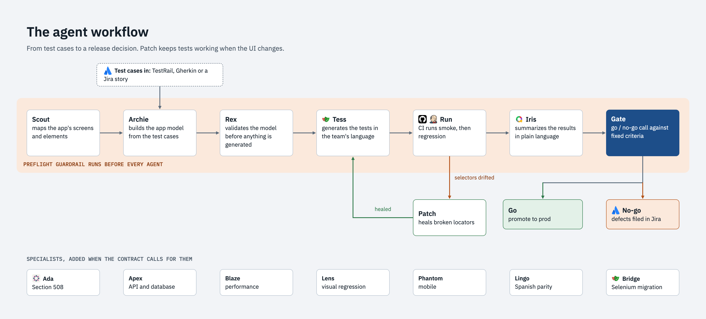
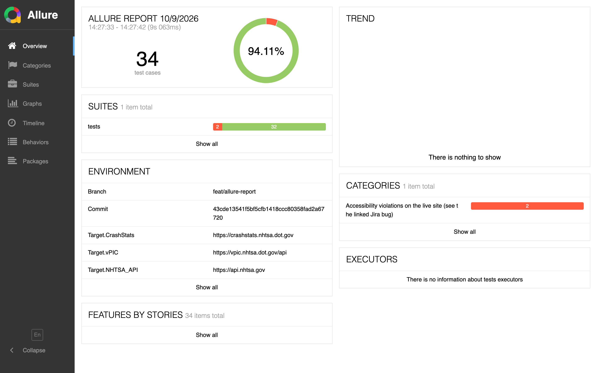
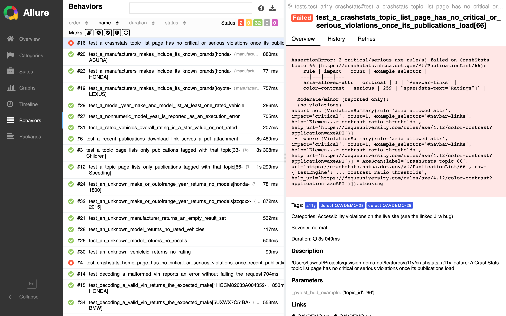
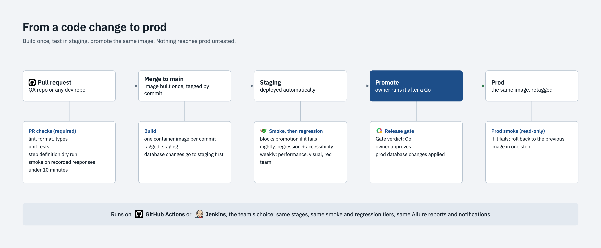

# QAVision

**An AI QA agent team that writes, runs and verifies tests, then makes an evidence-based release call.**

QAVision is a personal project by Ferkat Jawdat, built outside of work. It began as ForgeQA (v1), a Java/Cucumber skills framework, and was rebuilt as QAVision. The source code is private. This repo shows how it works and what it has produced.

## What it does

| Agent | Job |
|---|---|
| Scout | Maps an app's screens and elements |
| Archie / Rex | Builds a structured model of the tests, then validates it before anything is generated |
| Tess / Apex | Write UI and API tests: Playwright in TypeScript, Java or Python |
| Ada | Section 508 / WCAG 2.1 AA checks |
| Patch | Heals broken locators through a reviewed patch |
| Iris | Summarizes results in plain language |
| Gate | GO / NO-GO / CONDITIONAL release call against fixed criteria. A human decides |

The same skills run in Claude Code, GitHub Copilot and ChatGPT, generated from one source.

## The core idea: the AI writes, code verifies

An agent saying "tests pass" counts for nothing. A Jira ticket goes in, an agent writes the Gherkin, steps and page objects, and then:

1. **Sandbox run.** Tests run in a throwaway container with no secrets. Code records the results, not the agent.
2. **Mutation check.** Each expected value is changed and the test rerun. A test that still passes is weak, and the PR stays a draft.
3. **Independent review.** A model from a different family maps every acceptance criterion to an assertion line. Code checks each citation.
4. **CI**, then **a human merges.** Agents never merge, push to main or close tickets.

## Live run: public NHTSA sites

I ran the full flow end to end against public federal sites: the vPIC and api.nhtsa.gov APIs, plus CrashStats, CDAN and nhtsa.gov pages.

- **About 14 minutes** from Jira ticket to a verified pull request.
- **31 scenarios** across API, UI and accessibility, run on every push and on a daily schedule.
- **Real defects found:** WCAG contrast as low as 2.09:1 and `aria-expanded` on a `div` on CrashStats, and vPIC accepting model year 2999.

Accessibility failures are tagged with their Jira defect and reported apart from real test failures:

An agent-written feature from that run: [`examples/vpic_decoder.feature`](examples/vpic_decoder.feature).

## Security and governance

Organised around the OWASP Top 10 for LLM Applications and the NIST AI RMF.

- **Preflight guardrail** in code: allowed hosts, smoke-only on prod, approved AI provider, testing authorized.
- **Tool allowlist with no shell.** A prompt can't unlock a tool that isn't listed.
- **Prompt gateway:** PII/PHI redaction, hashed prompt logging, provider allowlist per engagement.
- **Hash-chained audit log**, role-based access, per-request cost caps and an emergency pause.
- **26-case red-team suite:** prompt injection, secret leaks and command smuggling.

## Delivery

GitHub Actions or Jenkins, Allure reports, Jira and TestRail sync, Slack or Teams summaries, run history and flaky-test trends in Postgres.

## Stack

TypeScript, Java, Python, Playwright, Cucumber / pytest-bdd, Allure, Claude Agent SDK, Playwright MCP, GitHub Actions, Docker, Supabase/Postgres, Jira, TestRail, Slack.

---
Source available for review on request.
